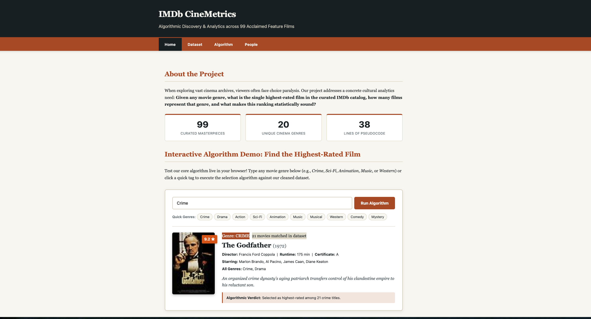

# IMDb CineMetrics — Best/Highest-Rated Movies by Genre
**Datalogical Thinking: Algorithm Design Group Project**  
**Repository:** [https://github.com/isabellamartensson/Project-Work-8](https://github.com/isabellamartensson/Project-Work-8)  

---

## 📖 Executive Summary
IMDb CineMetrics is an algorithmic cultural analytics project developed according to the five-step course project workflow. It addresses the challenge of identifying and contextualizing the highest-rated cinematic masterpieces across 20 distinct film genres from a curated collection of 99 top-rated IMDb films.

The project bundles together:
1. **Curated & Validated Dataset:** `IMDB_DATASET_clean.csv` (99 items, UTF-8 encoded, RFC 4180 compliant).
2. **Deterministic Algorithm:** Formal pseudocode (`algorithm/algorithm.md`) and executable Python implementation (`website/algorithm.py`) with an automated 5-point verification suite.
3. **Four-Page Responsive Web Application:** Built with semantic HTML5, modern editorial CSS, and a zero-dependency client-side JavaScript engine (`website/js/app.js` + `website/js/movies_data.js`) for seamless deployment on GitHub Pages.

---

## How to Run Locally

You can run the project locally using any of the following convenient methods:

### Python Built-In HTTP Server (Recommended)
Open your terminal or command prompt in the project root directory and run:
```bash
# Python 3
python3 -m http.server 8000
# or (Windows):
python -m http.server 8000
```
Then open your web browser and navigate to:
```
http://localhost:8000/
```
Then you should see what looks like the home page below:



---

## How to Run the Python Algorithm & Test Suite

The core algorithm is implemented in Python with both interactive CLI and automated testing modes.

### 1. Run the Automated Test Suite (5 Key Test Cases)
```bash
python3 algorithm.py --test
```
This executes the 5 verification tests defined in `algorithm_design.txt` (lowercase handling, tie resolution, exact token matching for *Music* vs *Musical*, non-existent genres, and blank input sanitization).

### 2. Run Interactive Query Mode
```bash
python3 algorithm.py
```
Prompt:
```text
Interactive IMDb Highest-Rated Movie Finder
Enter movie genre > Crime

Results for genre: Crime
  Total movies matching: 21
  Highest-rated movie:   The Godfather (9.2/10)
  Year of release:       1972
  Directed by:           Francis Ford Coppola
  Genres:                Crime, Drama
```

### 3. Direct Command-Line Query
```bash
python3 algorithm.py Sci-Fi
python3 algorithm.py Music
```

---


## 📊 Dataset Overview (Steps 1 & 2)

- **Source:** Curated catalog of acclaimed feature films from the Internet Movie Database (IMDb).
- **Size:** 99 unique films (exceeds the 50-item assignment requirement).
- **Key Columns:** `Series_Title`, `Released_Year`, `Certificate`, `Runtime`, `Genre`, `IMDB_Rating`, `Overview`, `Meta_score`, `Director`, `Star1-4`, `No_of_Votes`, `Gross`, `Poster_Link`.
- **Curation & Cleaning:**
  - Repaired Latin-1/Windows-1252 mojibake artifacts into valid UTF-8 characters (e.g., *Léon*, *Amélie*, *WALL·E*, *La vita è bella*).
  - Modeled multi-genre taxonomy using comma-separated tokens.
  - Sanitized synopsis formatting and verified RFC 4180 CSV compliance.

---

## 🧪 Verification & Test Suite

| Test ID | Test Description | Input | Expected Output | Status |
|---|---|---|---|:---:|
| 1 | Case-Insensitive Matching | `"drama"` | Matches 75 films; Top: *The Shawshank Redemption* (9.3) | **PASS** |
| 2 | Tie-Breaker Resolution | `"Crime"` | Matches 21 films; Retains first-encountered *The Godfather* (9.2) | **PASS** |
| 3 | Exact Token Disambiguation | `"Music"` | Matches 3 films (*Whiplash* 8.5); excludes *Musical* (*Anand* 8.4) | **PASS** |
| 4 | Non-Existent Genre Query | `"Superhero"` | Count = 0; clean friendly notification | **PASS** |
| 5 | Empty/Whitespace Input | `"   "` | Input validation error prompt | **PASS** |

---
